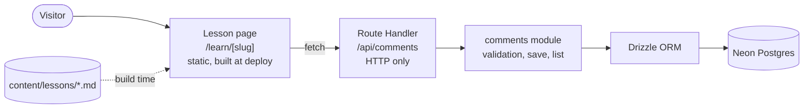

<div align="center">

# Idea to Shipped

**A small course on Matt Pocock's Claude Code skills and agentic coding, written as a journal of building this site.**

[](https://idea-to-shipped.vercel.app)


[**Read the course →**](https://idea-to-shipped.vercel.app)

<br/>

<a href="https://idea-to-shipped.vercel.app/learn/grilling"></a>

</div>

---

## About

Each Lesson covers one Skill: what it is, when to use it, what I typed, and what happened. Each one was written right after the step of building this site that used it, so the course is a record of the site being built.

You can leave a Comment on any Lesson in the Discussion panel beside it. You don't need an account.

This is my first full-stack app that actually made it to production. Everything from the first idea to the deploy was done with the skills the course teaches.

## The Lessons

**Part 1: Foundations**

| # | Lesson | What it covers |
|---|---|---|
| 0 | [Start here](https://idea-to-shipped.vercel.app/learn/start-here) | What the course is, what you need, how to read a Lesson |
| 1 | [How coding agents work](https://idea-to-shipped.vercel.app/learn/how-agents-work) | The agent loop, tools, permission modes, plan mode, CLAUDE.md |
| 2 | [The context window](https://idea-to-shipped.vercel.app/learn/context-window) | Tokens, the Smart zone, `/clear`, `/compact`, subagents, `/handoff` |
| 3 | [Skills](https://idea-to-shipped.vercel.app/learn/skills) | What a Skill is, installing Matt's Skills, `/setup-matt-pocock-skills`, `/ask-matt` |

**Part 2: The main flow**

| # | Lesson | What it covers |
|---|---|---|
| 4 | [Grilling](https://idea-to-shipped.vercel.app/learn/grilling) | Being interviewed until you and the agent want the same thing |
| 5 | [Domain modeling](https://idea-to-shipped.vercel.app/learn/domain-modeling) | `/grill-with-docs`: a shared glossary and decision records |
| 6 | [Prototype](https://idea-to-shipped.vercel.app/learn/prototype) | A throwaway build to settle a design question |
| 7 | [Spec + tickets](https://idea-to-shipped.vercel.app/learn/spec-and-issues) | Turning the conversation into a spec and tracer-bullet tickets |
| 8 | [TDD](https://idea-to-shipped.vercel.app/learn/tdd) | Red, green, one test at a time at an agreed seam |
| 9 | [Implement](https://idea-to-shipped.vercel.app/learn/implement) | `/implement` per ticket or `/implement-spec` for the whole spec |
| 10 | [Code review](https://idea-to-shipped.vercel.app/learn/code-review) | Checking the diff against standards and against the spec |
| 11 | [PR + ship](https://idea-to-shipped.vercel.app/learn/pr-and-ship) | A PR body a reviewer can trust, then preview, merge, production |
| 12 | [The main flow](https://idea-to-shipped.vercel.app/learn/main-flow) | The whole map: which Skill to type when |

**Part 3: When things go wrong**

| # | Lesson | What it covers |
|---|---|---|
| 13 | [Diagnosing bugs](https://idea-to-shipped.vercel.app/learn/diagnosing-bugs) | A tight feedback loop before any theory |
| 14 | [Triage](https://idea-to-shipped.vercel.app/learn/triage) | Turning incoming reports into agent-ready work |
| 15 | [Wizard](https://idea-to-shipped.vercel.app/learn/wizard) | Guided scripts for the steps only a human can do |

**Part 4: Level up**

| # | Lesson | What it covers |
|---|---|---|
| 16 | [Architecture](https://idea-to-shipped.vercel.app/learn/architecture) | Deep modules, seams and the architecture survey |
| 17 | [Retro](https://idea-to-shipped.vercel.app/learn/retro) | Improving the agent's environment after a build |
| 18 | [Wayfinder](https://idea-to-shipped.vercel.app/learn/wayfinder) | Planning a huge, foggy effort one decision at a time |
| 19 | [Models, effort & ultracode](https://idea-to-shipped.vercel.app/learn/models-effort-ultracode) | Choosing the model, the effort level, ultracode and fast mode |

## Features

- **Lessons are Markdown files.** They live in `content/lessons/` and are built into static pages at deploy time.
- **Comments on every Lesson.** Newest first, with an optional name. They're stored in Postgres.
- **A real REST API.** You can `curl` it, read it, and follow one request through every layer.
- **One database branch per environment.** Local, test, every PR preview and production each get their own Neon branch, so test data never reaches production.
- **Migrations run automatically.** Every Vercel build applies them, so a PR preview tries a migration on its own branch before it reaches production.
- **Tests use a real database.** No mocks. The tests run against a dedicated Neon `test` branch.

## How it works



Every layer has one job. The Route Handler only deals with HTTP. The comments module checks input and decides what's valid. Drizzle builds the SQL, and Neon stores the rows.

Lessons are files and Comments are database rows, so Postgres can't link them with a foreign key. Instead, each Comment stores its Lesson's permanent **slug**. The comments module rejects any slug that doesn't match a Lesson file. Slugs never change once a Lesson is published. ([ADR 0004](docs/adr/0004-comments-reference-lessons-by-permanent-slug.md))

## API

| Method | Path | Success | Errors |
|---|---|---|---|
| `GET` | `/api/comments?lesson=<slug>` | `200` + `[{ id, name, body, createdAt }]`, newest first | `400` if the slug is missing or unknown |
| `POST` | `/api/comments` | `201` + the created Comment | `400` + `{ error }` if the input is invalid |

The `POST` body is `{ lesson, name?, body }`. `body` is required and must be 1–2000 characters after trimming. `name` is optional, up to 50 characters, and shows as "Anonymous" when empty.

Try it:

```bash
# Read the Comments on a Lesson (live site)
curl "https://idea-to-shipped.vercel.app/api/comments?lesson=grilling"

# Post a Comment (against your local dev server, so the live site stays clean)
curl -X POST http://localhost:3000/api/comments \
  -H "Content-Type: application/json" \
  -d '{"lesson": "grilling", "name": "Ada", "body": "Great lesson!"}'
```

## Tech stack

| Layer | Choice |
|---|---|
| Framework | [Next.js 16](https://nextjs.org) (App Router, Route Handlers) |
| UI | React 19, one plain CSS file |
| Language | TypeScript |
| Markdown | [marked](https://marked.js.org) |
| Database | [Neon](https://neon.tech) serverless Postgres |
| ORM and migrations | [Drizzle ORM](https://orm.drizzle.team) + Drizzle Kit |
| Tests | [Vitest](https://vitest.dev) |
| Hosting | [Vercel](https://vercel.com), with the Neon-managed integration |

## Project structure

```
.
├── content/lessons/        # The Lessons, one Markdown file each (NN-<slug>.md)
├── src/
│   ├── app/
│   │   ├── page.tsx        # Home: the ordered list of Lessons
│   │   ├── learn/[slug]/   # Lesson page + Discussion (comment box)
│   │   └── api/comments/   # GET and POST /api/comments
│   ├── comments/           # Validation, saving and listing Comments
│   ├── lessons/            # Reading and parsing the Lesson files
│   └── db/                 # Drizzle schema and Neon client
├── drizzle/                # Migrations (committed, applied on every build)
├── docs/adr/               # Architecture Decision Records
└── GLOSSARY.md             # The words this project uses, and what they mean
```

## Running it locally

**You need:** Node.js 24 and a Neon project with a `vercel-dev` branch and a `test` branch.

```bash
git clone https://github.com/SiddharthMuramkar/idea-to-shipped.git
cd idea-to-shipped
npm install
```

Add two env files. Git ignores them, so they never get committed.

```bash
# .env.local      → the Neon vercel-dev branch, used by `npm run dev`
DATABASE_URL=postgres://...
DATABASE_URL_UNPOOLED=postgres://...   # optional, a direct connection for migrations

# .env.test.local → the Neon test branch, used by `npm test`
DATABASE_URL=postgres://...
```

> [!WARNING]
> The tests empty the `comments` table. That's why they only ever read `DATABASE_URL` from `.env.test.local`. Point it at the `test` branch, never at production.

Then:

```bash
npm run db:migrate        # apply migrations to your dev branch
npm run db:migrate:test   # apply migrations to the test branch
npm run dev               # http://localhost:3000
```

### Scripts

| Command | What it does |
|---|---|
| `npm run dev` | Start the dev server |
| `npm test` | Run the Vitest suite against the Neon `test` branch |
| `npm run lint` | Run ESLint |
| `npm run build` | Apply migrations, then build for production (what Vercel runs) |
| `npm run db:generate` | Generate a new migration from `src/db/schema.ts` |
| `npm run db:migrate` | Apply migrations to the dev branch |

## Writing a Lesson

Add a file to `content/lessons/` named `NN-<slug>.md`, with this header:

```markdown
---
title: Grilling
slug: grilling
order: 1
---
```

The page title and position come from the header, not the filename. The `NN-` prefix only keeps the files sorted on disk.

> [!IMPORTANT]
> **Never change a published slug.** Comments are linked to their Lesson by its slug, so renaming one would cut a Lesson off from its Comments.

## Deployment

The site runs on Vercel with the Neon-managed integration, which supplies `DATABASE_URL` in every environment.

| Environment | Neon branch |
|---|---|
| Local (`npm run dev`) | `vercel-dev` |
| Tests (`npm test`) | `test` |
| PR preview | `preview/<git-branch>`, created for each PR |
| Production | `main` |

Pushing straight to `main` is blocked. Changes go branch → pull request → check the preview deploy → squash merge, and then Vercel deploys to production.

## Decisions

The reasons behind the architecture are written down as ADRs:

1. [REST endpoints inside Next.js, not Server Actions or a separate backend](docs/adr/0001-rest-endpoints-in-nextjs.md)
2. [One Neon branch per environment, migrations applied on every build](docs/adr/0002-neon-branch-per-environment.md)
3. [Tests run against a real Neon branch, not a mocked database](docs/adr/0003-tests-hit-real-postgres.md)
4. [Comments reference file-based Lessons by a permanent slug, with no foreign key](docs/adr/0004-comments-reference-lessons-by-permanent-slug.md)

## What's not in v1

Some things were left out on purpose: accounts, editing, deleting or moderating Comments, spam protection, replies, dark mode, search, and a custom domain.

## Credits

- The skills this course teaches are by [Matt Pocock](https://github.com/mattpocock).
- Built with [Claude Code](https://claude.com/claude-code).

<div align="center">
<sub>Built by <a href="https://github.com/SiddharthMuramkar">Siddharth Muramkar</a> · From idea to shipped, one Skill at a time.</sub>
</div>
