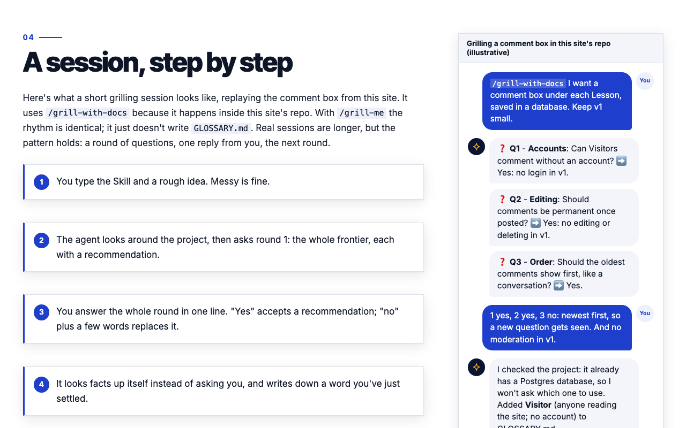

<div align="center">

# Idea to Shipped

**A small course on Matt Pocock's Claude Code skills and agentic coding, written as a journal of building this site.**

[](https://idea-to-shipped.vercel.app)


[**Read the course →**](https://idea-to-shipped.vercel.app)

<br/>

<a href="https://idea-to-shipped.vercel.app/learn/grilling"></a>

</div>

---

## About

Each Lesson covers one Skill: what it is, when to use it, what I typed, and what happened. Each one was written right after the step of building this site that used it, so the course is a record of the site being built.

You can leave a Comment on any Lesson in the Discussion band at its end. You don't need an account.

This is my first full-stack app that actually made it to production. Everything from the first idea to the deploy was done with the skills the course teaches.

## The Lessons

| # | Lesson | What it covers |
|---|---|---|
| 0 | [Start here](https://idea-to-shipped.vercel.app/learn/start-here) | What this course is and how to read it |
| 1 | [Grilling](https://idea-to-shipped.vercel.app/learn/grilling) | Stress-testing an idea before writing code |
| 2 | [Domain modeling](https://idea-to-shipped.vercel.app/learn/domain-modeling) | A shared glossary and ADRs |
| 3 | [Spec + issues](https://idea-to-shipped.vercel.app/learn/spec-and-issues) | Turning the plan into a spec and ordered issues |
| 4 | [Wizard](https://idea-to-shipped.vercel.app/learn/wizard) | Guided setup for accounts, keys and environments |
| 5 | [Prototype](https://idea-to-shipped.vercel.app/learn/prototype) | A throwaway build to settle a design question |
| 6 | [TDD](https://idea-to-shipped.vercel.app/learn/tdd) | Red, green, refactor against a real database |
| 7 | [Code review](https://idea-to-shipped.vercel.app/learn/code-review) | Checking code against standards and against the spec |
| 8 | [PR + ship](https://idea-to-shipped.vercel.app/learn/pr-and-ship) | Branch, preview deploy, merge, production |
| 9 | [Diagnosing bugs](https://idea-to-shipped.vercel.app/learn/diagnosing-bugs) | A step-by-step loop for hard bugs |
| 10 | [Models, effort & ultracode](https://idea-to-shipped.vercel.app/learn/models-effort-ultracode) | The four dials: model, effort, ultracode and fast mode |
| 11 | [The main flow](https://idea-to-shipped.vercel.app/learn/main-flow) | How the Skills fit together, from idea to shipped |

## Features

- **Lessons are Markdown files.** They live in `content/lessons/` and are built into static pages at deploy time.
- **Typed Lesson blocks.** A rewritten Lesson has goals, Scenes (small pictures that build up step by step), Checkpoints and a Final test, each question with its answer one click away.
- **Comments on every Lesson.** Newest first, with an optional name. They're stored in Postgres.
- **A real REST API.** You can `curl` it, read it, and follow one request through every layer.
- **One database branch per environment.** Local, test, every PR preview and production each get their own Neon branch, so test data never reaches production.
- **Migrations run automatically.** Every Vercel build applies them, so a PR preview tries a migration on its own branch before it reaches production.
- **Tests use a real database.** No mocks. The tests run against a dedicated Neon `test` branch.

## How it works


Every layer has one job. The Route Handler only deals with HTTP. The comments module checks input and decides what's valid. Drizzle builds the SQL, and Neon stores the rows.

Lessons are files and Comments are database rows, so Postgres can't link them with a foreign key. Instead, each Comment stores its Lesson's permanent **slug**. The comments module rejects any slug that doesn't match a Lesson file. Slugs never change once a Lesson is published. ([ADR 0004](docs/adr/0004-comments-reference-lessons-by-permanent-slug.md))

Checkpoints and the Final test are part of the Lesson file, so they are in the static page too. For now, each question shows its answer and why every option is right or wrong in a "Show the answer" box, and nothing is saved. Saving Answers and grading them on the server is designed ([ADR 0005](docs/adr/0005-answers-reference-questions-by-permanent-id.md), [ADR 0006](docs/adr/0006-anonymous-visitor-cookie-and-server-regrading.md)) but not built yet.

## API

| Method | Path | Success | Errors |
|---|---|---|---|
| `GET` | `/api/comments?lesson=<slug>` | `200` + `[{ id, name, body, createdAt }]`, newest first | `400` if the slug is missing or unknown |
| `POST` | `/api/comments` | `201` + the created Comment | `400` + `{ error }` if the input is invalid |

**Comments.** The `POST` body is `{ lesson, name?, body }`. `body` is required and must be 1–2000 characters after trimming. `name` is optional, up to 50 characters, and shows as "Anonymous" when empty.

Try it:

```bash
# Read the Comments on a Lesson (live site)
curl "https://idea-to-shipped.vercel.app/api/comments?lesson=grilling"

# Post a Comment (against your local dev server, so the live site stays clean)
curl -X POST http://localhost:3000/api/comments \
  -H "Content-Type: application/json" \
  -d '{"lesson": "grilling", "name": "Ada", "body": "Great lesson!"}'
```

## Tech stack

| Layer | Choice |
|---|---|
| Framework | [Next.js 16](https://nextjs.org) (App Router, Route Handlers) |
| UI | React 19, one plain CSS file |
| Language | TypeScript |
| Markdown | [marked](https://marked.js.org) |
| Database | [Neon](https://neon.tech) serverless Postgres |
| ORM and migrations | [Drizzle ORM](https://orm.drizzle.team) + Drizzle Kit |
| Tests | [Vitest](https://vitest.dev) |
| Hosting | [Vercel](https://vercel.com), with the Neon-managed integration |

## Project structure

```
.
├── content/lessons/        # The Lessons, one Markdown file each (NN-<slug>.md)
├── src/
│   ├── app/
│   │   ├── page.tsx        # Home: the ordered list of Lessons
│   │   ├── learn/[slug]/   # Lesson page: blocks, Scenes, Checkpoints, Final test, Discussion
│   │   └── api/            # comments
│   ├── comments/           # Validation, saving and listing Comments
│   ├── lessons/            # Reading, parsing and checking the Lesson files, plus the course lint
│   └── db/                 # Drizzle schema and Neon client
├── drizzle/                # Migrations (committed, applied on every build)
├── docs/
│   ├── adr/                # Architecture Decision Records
│   └── authoring-lessons.md  # How to write a Lesson: header, blocks, questions, lint
└── GLOSSARY.md             # The words this project uses, and what they mean
```

## Running it locally

**You need:** Node.js 24 and a Neon project with a `vercel-dev` branch and a `test` branch.

```bash
git clone https://github.com/SiddharthMuramkar/idea-to-shipped.git
cd idea-to-shipped
npm install
```

Add two env files. Git ignores them, so they never get committed.

```bash
# .env.local      → the Neon vercel-dev branch, used by `npm run dev`
DATABASE_URL=postgres://...
DATABASE_URL_UNPOOLED=postgres://...   # optional, a direct connection for migrations

# .env.test.local → the Neon test branch, used by `npm test`
DATABASE_URL=postgres://...
```

> [!WARNING]
> The database tests empty the `comments` table. That's why they only ever read `DATABASE_URL` from `.env.test.local`. Point it at the `test` branch, never at production.

Then:

```bash
npm run db:migrate        # apply migrations to your dev branch
npm run db:migrate:test   # apply migrations to the test branch
npm run dev               # http://localhost:3000
```

Only writing Lessons? You don't need a database or either env file for that. `npm install`, then `npm run test:content` checks every Lesson.

### Scripts

| Command | What it does |
|---|---|
| `npm run dev` | Start the dev server |
| `npm test` | Run every test: the content tests, then the database tests against the Neon `test` branch |
| `npm run test:content` | Check every Lesson file, run the course lint and render every Lesson page. Needs no database or env file |
| `npm run lint` | Run ESLint |
| `npm run build` | Apply migrations, then build for production (what Vercel runs). A broken Lesson fails it |
| `npm run db:generate` | Generate a new migration from `src/db/schema.ts` |
| `npm run db:migrate` | Apply migrations to the dev branch |
| `npm run db:migrate:test` | Apply migrations to the test branch |

## Writing a Lesson

The full guide, with an annotated example of every block, is [docs/authoring-lessons.md](docs/authoring-lessons.md). The short version follows.

Add a file to `content/lessons/` named `NN-<slug>.md`, where `NN` is its `order` padded to two digits. Start it with this header:

```markdown
---
title: Grilling
slug: grilling
order: 1
part: 2
image: /photos/grilling.jpg
imageAlt: A woman in glasses takes notes while questioning a man across an office desk.
imageCredit: Vitaly Gariev
---
```

| Key | What it is |
|---|---|
| `title` | The Lesson's title |
| `slug` | Its permanent id, used in its URL (`/learn/grilling`) |
| `order` | Its position in the course; must match `NN` |
| `part` | Its Part: `1` Foundations, `2` The main flow, `3` When things go wrong, `4` Level up |
| `image`, `imageAlt`, `imageCredit` | Its photo under `public/`, a description for screen readers, and the photographer's name |

Any other key is an error, and so is a slug or `order` that another Lesson already uses. The page title and position come from the header, not the filename.

**The body is Markdown.** `## ` headings split it into Sections, and `==key phrase==` highlights a phrase. The special parts of a Lesson are fenced code blocks whose first word names the kind. They must sit at the top level, at the start of a line: one inside a list, a `> ` quote or another block is an error.

| Block | What it makes |
|---|---|
| `goals` | The 3–4 things a Visitor will be able to do, before the first `##` |
| `scene chat` / `terminal` / `flow` / `files` / `meter` | A Scene: a small picture beside the text, with its steps as numbered captions. At most one per Section (never in the intro) |
| `checkpoint <id>` | One question in the text, with its answer and per-option feedback under "Show the answer". Its prompt is one paragraph; orderings go in the options |
| `test <id>` | One Final test question. They sit together at the end, each with its own answer box |
| `callout tip` / `watch-out` / `big-idea` | A highlighted box |
| `try` | A "Your turn" exercise, with copy buttons on its code |
| `site-story` | How I used it building this site |
| `sources` | Where the facts come from, as a list of links |

Check your work:

```bash
npm run test:content   # parse every Lesson and run the course lint (no database needed)
npm run dev            # then read it at http://localhost:3000/learn/<slug>
```

A broken Lesson fails the build, and the error names the file, the block and the question id.

> [!IMPORTANT]
> **Never change a published slug or question id.** Comments and Answers are linked to their Lesson by its slug, and Answers to their question by its id, so renaming either cuts them off. You can reword a question and its options, but never reorder or remove options: an option's id is its position (`a`, `b`, `c`, `d`). To change what a question asks, give it a new id. ([ADR 0004](docs/adr/0004-comments-reference-lessons-by-permanent-slug.md), [ADR 0005](docs/adr/0005-answers-reference-questions-by-permanent-id.md))

## Deployment

The site runs on Vercel with the Neon-managed integration, which supplies `DATABASE_URL` in every environment.

| Environment | Neon branch |
|---|---|
| Local (`npm run dev`) | `vercel-dev` |
| Tests (`npm test`) | `test` |
| PR preview | `preview/<git-branch>`, created for each PR |
| Production | `main` |

Pushing straight to `main` is blocked. Changes go branch → pull request → check the preview deploy → squash merge, and then Vercel deploys to production.

## Decisions

The reasons behind the architecture are written down as ADRs:

1. [REST endpoints inside Next.js, not Server Actions or a separate backend](docs/adr/0001-rest-endpoints-in-nextjs.md)
2. [One Neon branch per environment, migrations applied on every build](docs/adr/0002-neon-branch-per-environment.md)
3. [Tests run against a real Neon branch, not a mocked database](docs/adr/0003-tests-hit-real-postgres.md)
4. [Comments reference file-based Lessons by a permanent slug, with no foreign key](docs/adr/0004-comments-reference-lessons-by-permanent-slug.md)
5. [Answers reference questions by permanent ids, with no foreign key](docs/adr/0005-answers-reference-questions-by-permanent-id.md) (not built yet)
6. [Visitors are a random cookie ID, and Answers are graded in the browser, then re-graded on the server](docs/adr/0006-anonymous-visitor-cookie-and-server-regrading.md) (not built yet)
7. [Lesson blocks are typed fenced Markdown, not MDX, and scroll effects are CSS plus IntersectionObserver, not an animation library](docs/adr/0007-typed-markdown-blocks-and-css-scroll-effects.md) (Scene stepping not built yet)

## What's not in v1

Some things were left out on purpose: accounts, editing, deleting or moderating Comments, spam protection, replies, dark mode, search, and a custom domain.

## Credits

- The skills this course teaches are by [Matt Pocock](https://github.com/mattpocock).
- Built with [Claude Code](https://claude.com/claude-code).

<div align="center">
<sub>Built by <a href="https://github.com/SiddharthMuramkar">Siddharth Muramkar</a> · From idea to shipped, one Skill at a time.</sub>
</div>
